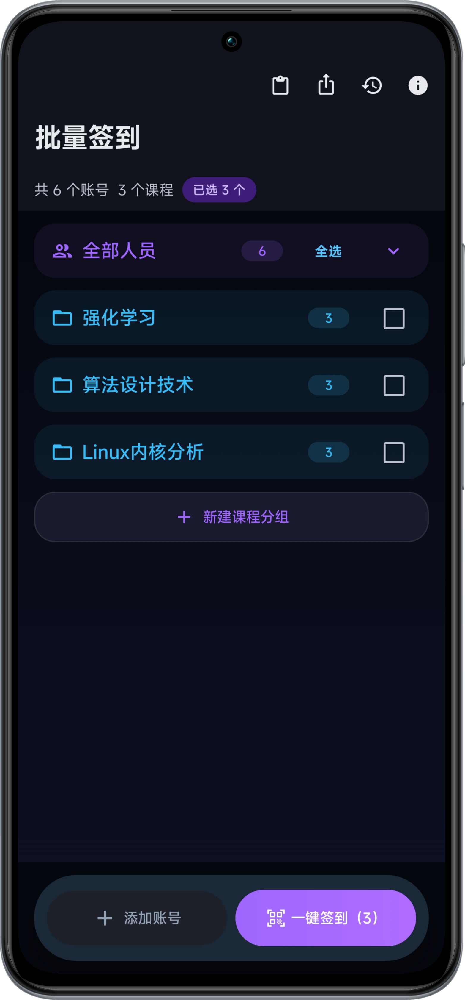
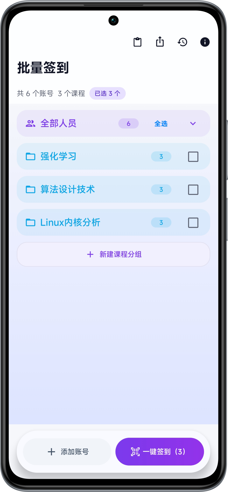

# 同济大学Canvas系统课堂签到助手

<div align="center">
<p align="center">
  
</p>
<p align="center">
一个专为同济大学 Canvas 系统课堂签到场景设计的 Android 批量签到应用。<br>
如果帮到你，请给我点个star，这对我蛮重要，谢谢~
</p>
</div>

## ✨ 项目简介

本应用实现了多人签到功能：多个用户事先通过统一认证平台登录，然后APP分别拦截并保存好每个用户的认证信息，用这个APP扫描二维码，可以并发完成多个人的签到。

认证信息永久有效，只需获取一次。所有信息处理均在app内完成。

## 📖 使用指南
1. 点击左下方 **添加账号**，点击“在线登陆添加”进入统一认证登录页，可一键切换移动/桌面模式（支持微信扫码登录）。
2. 登录成功后等待 5 秒，系统会自动提取认证信息。
3. 回到主界面，在卡片中管理账号，开启需要参与本次签到的用户，点击 **一键签到** 完成批量签到。
4. 如需手动录入 Cookies，使用 添加账号-手动录入Cookies 按钮。

> 右上方支持从剪贴板导入导出用户信息。

## 🆕 最新特性
v3.3.0
- 支持一键全选"全部人员"
- 重新扫码后仅补签失败账号
- 在线登陆添加账号后自动验证，并按姓名和学号命名
- 增加"签到历史"
- 签到改为HTTPS直发，解决了多人并发签到时Cookie穿透的问题，能丝滑的进行多人签到了~
- 调整布局并修复了一些bug 

v3.2.1
- 深色模式

v3.2.0
- 支持新建课程分组

v3.0.0
- 主界面新增进度摘要、滚动动画与批量操作工具栏。
- OAuth2 登录界面提供卡片式提示、分段按钮和实时状态提示。
- 批量签到页拥有状态驱动的卡片、骨架加载动画与可折叠调试 WebView。
- 全新的 ML Kit 扫码器，支持小尺寸/倾斜二维码、手电筒、重新扫描及实时提示。

✅ 新的UI<br>
✅ 优化动画和操作逻辑<br>
✅ 大幅增加二维码识别速度和准确率<br>

<table>
  <tr>
    <td align="center"></td>
    <td align="center"></td>
  </tr>
</table>

左滑信息卡片🈶删除按钮

### 应用配置
- **最小SDK**：28 (Android 9.0)
- **目标SDK**：36 (Android 16)

### 权限要求

- `CAMERA`：相机权限，用于二维码扫描
- `INTERNET`：网络权限，用于登录、账号验证、签到

## 新增web版：[点击跳转仓库](https://github.com/mmmlllnnn/TongJi_Canvas_Web)

无需下载，打开链接即可使用，推荐 iOS 用户试试。

但无法多人并发，一次只能签到一人。

截止20261107，日均调用50次+，代码开源，推荐自行搭建服务。

[点此查看使用说明](https://handsome.eu.org/canvas/guide.html)

[在线访问：https://handsome.eu.org/canvas/index.html](https://handsome.eu.org/canvas/index.html)


```
URL中传入你的认证信息后，打开只会显示简洁版：

https://handsome.eu.org/canvas/index.html?_canvas_middle_session=替换为你的cookie

```


<br>

## 新增 iOS 客户端：

由 [CrbnsCat10n](https://github.com/CrbnsCat10n) 开发。

原生 iOS 客户端源码及当前功能范围见 [ios/README.md](ios/README.md)。

因 Apple 安装限制，需要自行构建和签名，暂不提供统一安装包。

## 目录树：

```
canvas_batch_sign/
├── app/       # Android 客户端
├── ios/       # iOS 客户端
├── gradle/    # Android 构建工具配置
└── pic/       # 项目截图与展示图片
```

```
app/src/main/java/com/mln/tongji_canvas/
├── MainActivity.kt               # 主活动，导航控制与更新提示
├── AboutActivity.kt              # 关于应用页面
├── data/                         # 数据层
│   ├── AppUpdateChecker.kt       # 应用更新检查
│   ├── CredentialVerifier.kt     # 账号认证信息验证
│   ├── SessionModels.kt          # 用户会话、认证信息与课程数据模型
│   ├── SessionRepository.kt      # 用户会话、课程分组与选择状态存储
│   ├── SignHistoryStore.kt       # 签到历史记录与本地存储
│   └── SignInClient.kt           # 签到请求与结果处理
└── ui/                           # 界面层
    ├── MainScreen.kt             # 主界面，账号与课程分组管理
    ├── OAuth2LoginScreen.kt      # OAuth2 登录界面
    ├── EnhancedScannerScreen.kt  # 增强二维码扫描界面（当前使用）
    ├── ScannerScreen.kt          # 基础二维码扫描界面
    ├── SimpleScannerScreen.kt    # 简易二维码扫描界面
    ├── BatchSignScreen.kt        # 批量签到界面
    ├── SignHistoryScreen.kt      # 签到历史界面
    ├── components/               # 通用界面组件
    │   └── StatePanels.kt        # 空状态、错误提示与加载占位组件
    ├── qr/                       # 二维码扫描状态管理
    │   └── QrScannerState.kt     # 扫描控制器与状态
    └── theme/                    # 应用主题
        ├── Color.kt              # 配色定义
        ├── Theme.kt              # 主题配置
        └── Type.kt               # 字体与排版样式
```
