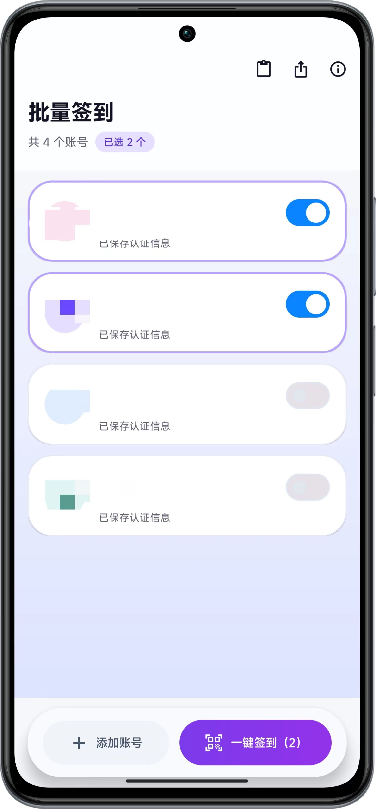
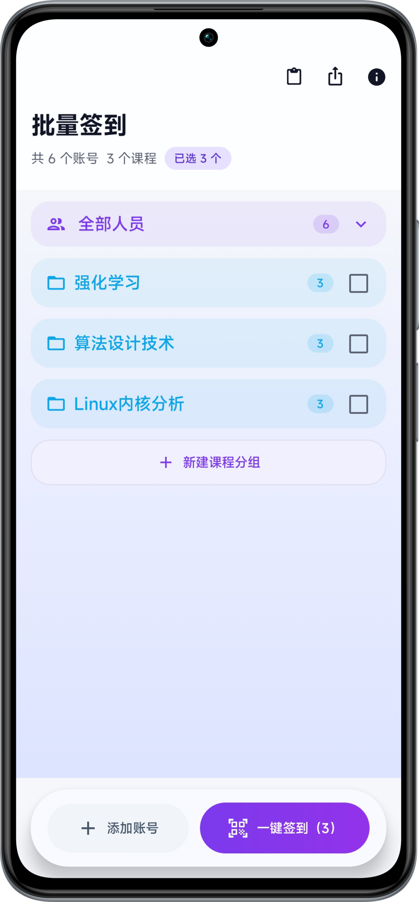
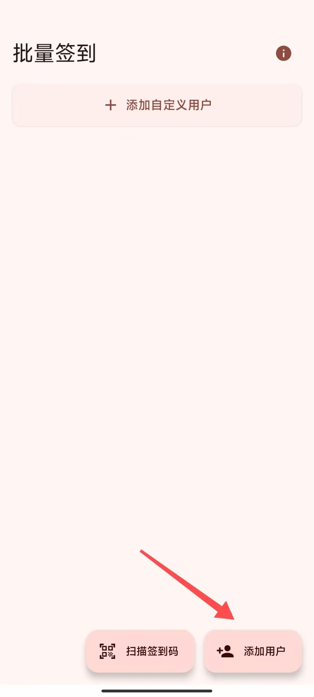
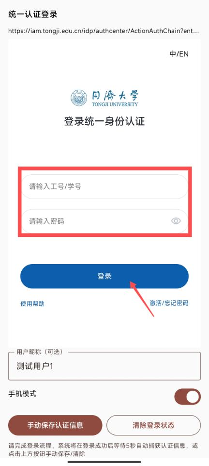
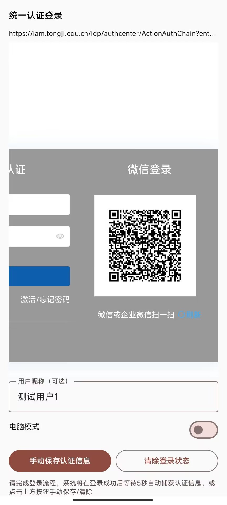
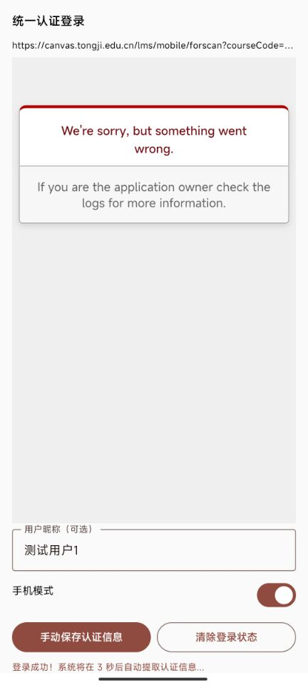
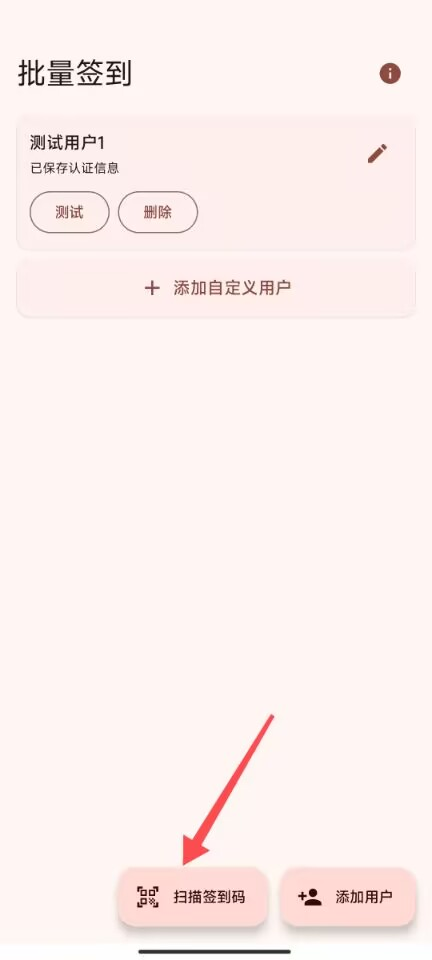
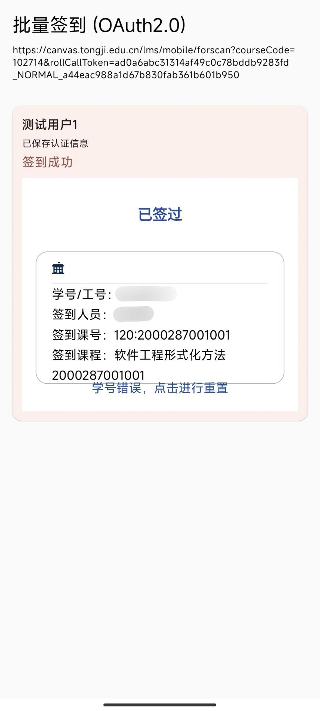
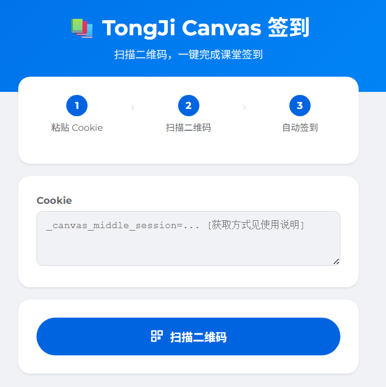
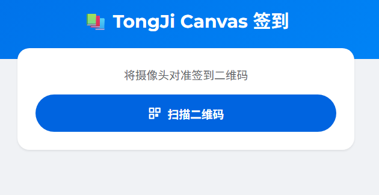

# 同济大学Canvas系统课堂签到助手

<div align="center">
<p align="center">
  
</p>
<p align="center">
一个专为同济大学 Canvas 系统课堂签到场景设计的 Android 批量签到应用。<br>
如果帮到你，请给我点个star，这对我蛮重要，谢谢~
</p>
</div>


## ✨ 项目简介

本应用实现了多人签到功能：多个用户事先通过统一认证平台登录，然后APP分别拦截并保存好每个用户的认证信息，用这个APP扫描二维码，可以并发完成多个人的签到。

认证信息**长期有效**，正常情况下只需获取一次：实测同一凭据可跨月复用，且重复请求不会使原凭据作废（服务端虽会轮换 `Set-Cookie`，但旧值仍然可用）。该部署未对凭据施加实际时间限制，**只有服务端显式注销或用户改密才会失效**；凭据失效时签到接口会返回 `302 → iam.tongji.edu.cn`，App 会据此提示重新登录。

> ### 🔐 凭据安全提示
> - 本 App 需要代持他人的 Canvas 会话凭据，**凭据以明文存放在应用私有目录的 SharedPreferences（`sessions.xml`）中**，未做加密存储；已尽量降低外泄面：关闭系统备份/云同步与设备迁移对该文件的提取（`allowBackup="false"` + 排除 `sessions.xml`），并禁止截屏（`FLAG_SECURE`）。但 Root/已解锁设备或调试工具仍可能读到该文件。
> - **「导出用户信息」等于把明文凭据分享出去**：导出的内容含完整 Cookie，任何拿到它的人都能以该账号身份签到。请只导入/导出可信设备，用完及时删除，切勿发到群聊或公开仓库。
> - 明文凭据可被任意第三方使用，且**无法从 Cookie 反推密码**；一旦怀疑泄露，唯一可靠的处理方式是让对方在统一认证平台**改密或注销会话**。


## 📖 使用指南
1. 点击左下方 **添加账号**，点击“在线登陆添加”进入统一认证登录页，可一键切换移动/桌面模式（支持微信扫码登录）。
2. 登录成功后等待 5 秒，系统会自动提取认证信息。
3. 回到主界面，在卡片中管理账号，开启需要参与本次签到的用户，点击 **一键签到** 完成批量签到。
4. 如需手动录入 Cookies，使用 添加账号-手动录入Cookies 按钮。

> 右上方支持从剪贴板导入导出用户信息。

## 🆕 最新特性
v3.2.1
- 深色模式

v3.2.0
- 支持新建课程分组

v3.0.0
- 主界面新增进度摘要、滚动动画与批量操作工具栏。
- OAuth2 登录界面提供卡片式提示、分段按钮和实时状态提示。
- 批量签到页拥有状态驱动的卡片、骨架加载动画与可折叠调试 WebView。
- 全新的 ML Kit 扫码器，支持小尺寸/倾斜二维码、手电筒、重新扫描及实时提示。

✅ 新的UI<br>
✅ 优化动画和操作逻辑<br>
✅ 大幅增加二维码识别速度和准确率<br>

<table>
  <tr>
    <td align="center"></td>
    <td align="center"></td>
  </tr>
</table>

左滑信息卡片🈶删除按钮

---
<!-- 旧版：
<table>
  <tr>
    <td></td>
    <td></td>
    <td></td>
  </tr>
  <tr>
    <td></td>
    <td></td>
    <td></td>
  </tr>
</table> -->


## 新增web版：[点击跳转仓库](https://github.com/mmmlllnnn/TongJi_Canvas_Web)

我去，本来只是个 demo，结果用的人数有点超乎想象啊，2个月调用了1375次。

但是为什么只有4个 star [生气] 🤡 老白嫖怪们~

不管了，开始正式维护 web 版

[点此查看使用说明](https://handsome.eu.org/canvas/guide.html)

[在线版访问：https://handsome.eu.org/canvas/index.html](https://handsome.eu.org/canvas/index.html)



```
URL中传入你的认证信息后，打开只会显示简洁版：

https://handsome.eu.org/canvas/index.html?_canvas_middle_session=替换为你的cookie

```



<br>


[旧]

~~web版又称呆瓜版， 无需安装APP ，~~
~~只需要对方在浏览器打开链接,对准二维码完成签到。~~

~~需要事先构建自己的专属url链接: 在?后替换为你的认证信息。~~


~~https://你的域名/index.html?_canvas_middle_session=xxxxxxx~~


~~在线版访问（自己搭的 不排除某天关停）：[https://handsome.eu.org/cdn_js/index.html?_canvas_middle_session=xxxxxxx](https://handsome.eu.org/cdn_js/index.html?_canvas_middle_session=xxxxxxx)~~


---

### 应用配置
- **最小SDK**：28 (Android 9.0)
- **目标SDK**：36 (Android 16)

### 权限要求
- `CAMERA`：相机权限，用于二维码扫描
- `INTERNET`：网络权限，用于登录和签到

```
app/src/main/java/com/mln/tongji_canvas/
├── MainActivity.kt              # 主活动，导航控制
├── AboutActivity.kt             # 关于页
├── data/                       # 数据层
│   ├── SessionModels.kt        # 数据模型定义
│   └── SessionRepository.kt    # 数据存储管理
└── ui/                         # 界面层
    ├── MainScreen.kt           # 主界面，用户管理
    ├── OAuth2LoginScreen.kt    # OAuth2登录界面
    ├── EnhancedScannerScreen.kt # 增强扫描界面（唯一扫码入口）
    ├── BatchSignScreen.kt      # 批量签到界面
    ├── components/             # 状态面板等公共组件
    ├── qr/                     # 扫码控制器
    └── theme/                  # 主题与配色
```
---

## 🧭 Roadmap / TODO

> 本节区分「已验证的事实」「已实现」「未实现」，供后续 PR 参考。
> 详细技术审计另见 [`OPTIMIZATION.md`](./OPTIMIZATION.md)。

### ✅ 已完成（本仓库已落地）

- [x] **构建可用性修复**
  - [x] 恢复 `gradle/wrapper/gradle-wrapper.jar`（原先被 `.gitignore` 的 `*.jar` 误忽略，导致新克隆/CI 直接 `ClassNotFoundException: GradleWrapperMain`）
  - [x] `.gitignore` 增加 `!gradle/wrapper/gradle-wrapper.jar` 白名单
  - [x] `app/build.gradle.kts` 显式指定 Kotlin `jvmTarget = JVM_21`，修复 JDK 25 下 `Inconsistent JVM-target compatibility` 构建失败
  - [x] `gradle.properties` 开启 `org.gradle.daemon` / `org.gradle.caching`
  - [x] 实测通过：`:app:assembleDebug` BUILD SUCCESSFUL，产出 4 个 APK
- [x] **`OPTIMIZATION.md`**：全量技术审计报告（含逐条行号证据与分级 P0–P4）
- [x] **`.env` 加入 `.gitignore`**：避免真实会话凭据被提交到公开仓库

### 🔬 已验证的接口与行为事实（后续开发请以此为准）

| 事实 | 结论 |
|---|---|
| 签到请求形态 | **`GET /lms/mobile/forscan?courseCode=&rollCallToken=`**，仅需 `Cookie: _canvas_middle_session`；**无 POST、无 CSRF、无 JS**，可直接用 HTTP 客户端发 |
| 二维码内容 | **就是签到 URL 本身**，加载即签到。`rollCallToken = <signHistoryId>_<模式>_<密钥>`，模式段为 `NORMAL / UNNORMAL / LATE` |
| 服务端 | 确认为标准 **canvas-lms**（`X-Canvas-Meta`、`X-Rate-Limit-Remaining`、`nginx + Phusion Passenger`） |
| 身份来源 | **`forscan` 返回的 HTML 里直接含姓名/学号/课程**（实测拿到 `姚董毅 / 2551830 / 软件工程形式化方法`），**一条请求即可**，无需额外接口 |
| Canvas 官方 API | 同一 cookie 在 `/lms/*` 有效，但 `/api/v1/users/self/profile`、`/api/v1/courses`、`/profile` **一律 401** → **该凭据只对 `/lms` 中间件层有效，不能用于 Canvas API**（`/api/v1/users/self` 恒 404，勿用于判活） |
| 凭据寿命（实测） | **凭据长期有效，实测可跨月复用**。同一凭据连续请求后**原凭据依然有效**；服务端每次响应会 `Set-Cookie` 轮换出新的 `_canvas_middle_session`，但**原凭据不被作废**（原凭据 / 轮换后 cookie 均可识别为同一用户）→ `session_timeout` 在该部署上很可能未启用或设得极长 |
| 凭据失效信号 | forscan 返回 **302 → `iam.tongji.edu.cn/idp/oauth2/authorize`** 是唯一可靠的失效信号。**不要依赖"过期时间"判断凭据是否可用** |
| 二维码前置校验 | `GET /lms-lti-rollcall-tongji/sign/getSignStatus/{courseCode}` **公开无需鉴权**，返回 `{"body":{"status":"off"}}` → 可预判"当前是否有正在进行的点名" |
| 已签名单 | `GET /lms-lti-rollcall-tongji/rollcall/{signHistoryId}/qr` → `body.signedUserIds[]` 是权威已签名单，但**需要教师 LTI JWT**，学生 cookie 读不到 |
| 限流 | Canvas `RequestThrottle` 按**用户/token**分桶，IP 仅匿名流量兜底 → **多账号同 IP 不共享限流桶**，并发不是瓶颈 |
| HTTP/2 | 该服务器 ALPN **仅协商 `http/1.1`**，无需伪装 h2 |
| 网络耗时 | DNS ≈4.6ms、TCP ≈0.6ms、TLS ≈12ms、整请求 ≈28ms → **预热 DNS/TCP 是噪声**，真正的耗时在客户端 WebView 与硬编码延迟 |
| 凭据失效机制（已更正） | 先前依 canvas-lms 源码推断为「默认 20 分钟空闲超时」，**该推断已被实测否定**（跨月凭据仍有效、同一凭据可反复使用且不被作废）。**结论以实测为准：该部署未对凭据施加实际时间限制**；仅当服务端显式注销或用户改密才失效 |
| 凭据可逆性 | **不可逆**。IAM `SESSION` = `base64(随机UUID)`（零载荷的指针）；Canvas 会话为 AES-128-CBC + HMAC-SHA1，密钥存于服务端数据库 → **无法从 cookie 反推学号/密码** |
| IAM 密码传输 | 密码在浏览器内先经 **RSA-1024 公钥**加密再 POST（`/idp/themes/default/js/main/crypt.js`）。该硬编码值是**公钥**（`MIGf…`），只能加密不能解密；无客户端对称密钥、无时间戳字段 |
| 服务端会话 cookie | Canvas 会话 cookie **无 `Expires`**（浏览器会话级），WebView 进程结束即丢 → 若出现"重启后需重新登录"，根因多半是未 `CookieManager.flush()` 持久化，而非服务端超时 |

### ✅ 已实现（本轮）

**签到核心**
- [x] **签到引擎改为 HTTP 直发**（替代 N 个 WebView）：每账号一个 GET，Cookie 只放请求头
- [x] **消除 Cookie 串号**：不再使用全局 `CookieManager`，每会话独立 Cookie 头
- [x] **结果解析含失败原因**：`签到失败：xxx`、`未知错误`、302→IAM 分别归类
- [x] **结构化结果模型** `SignResult`（7 种状态 + 原因 + 姓名/学号 + 耗时 + 原始片段）
- [x] **按原因分区结果** + 「只重试失败项」（不重试已成功/已签过/未选课的）
- [x] **重试交给用户**：自动重试仅覆盖瞬时失败、最多 2 次；其余由用户手动重试
- [x] **时间窗 UI**：倒计时（估算）、已发起/已完成/成功/失败计数
- [x] **超时与取消**：每账号 15s 预算、并发上限 4、离开页面取消全部在途请求

**凭据与账号**
- [x] **导入后立即验证**：用 forscan 页面一次拿到 *凭据有效性 + 真实姓名 + 学号*
- [x] **账号自动命名**：使用真实姓名(学号)，替代 `用户+毫秒时间戳`
- [x] **稳定账号标识 identityKey**：按学号去重，修复「每次登录都新增重复账号」
- [x] **验证超时/失败不静默**：提示原因，由用户选择「仍要保存（标记未验证）」或「不保存」
- [x] **凭据可用性检测**：失效以 302→IAM 呈现为「凭据已失效，请重新登录」

**清理与安全**
- [x] **删除打印完整 Cookie 的日志**（原 8 处 → 0 处）
- [x] **删除死代码**：`ScannerScreen`/`SimpleScannerScreen`/`processCookieQueue`/`forceLoadTrigger`/`extractCodeFromUrl`/`exchangeCodeForToken`/`ScanResult`/`isTokenValid`/`ActiveCourseId`/未使用路由与依赖
- [x] **凭据加固**：`allowBackup=false` + 显式排除 `sessions.xml`（含 device-transfer）、`FLAG_SECURE`、禁止混合内容
- [x] **仓库并发**：`SessionRepository` 读-改-写加 `Mutex`，避免并发导入丢更新
- [x] **UI 状态修复**：加载三态、课程全选改为派生状态、关键输入 `rememberSaveable`、头像索引 `floorMod`
- [x] **删除硬编码延迟**：登录 5000ms 倒计时改为轮询会话 Cookie；批量页 500ms 延迟移除
- [x] **UA 策略**：每账号按 hash 分配独立 UA，不再共用硬编码设备串

### 🚧 未实现

**产品**
- [ ] **扫码前置校验**：用公开的 `getSignStatus` 预判当前是否有点名
- [ ] **二维码去重**：按 `signHistoryId` 判断是否重复扫同一个点名
- [ ] **同步签到状态**：查看「自己那几个账号是否已签上」（全班名单需教师 JWT，不可得）
- [x] **一键勾选全部 / 取消全选**（「全部人员」头部按钮，显示「已选 N / 总数」）
- [ ] **常用组合置顶**（按最近常用排序，减少现场逐个点选）
- [ ] **可复制的文本汇总**：一键复制「账号 + 状态 + 时间」纯文本发群确认
      （已确认走文本而非截图，因此 `FLAG_SECURE` 保持不变、无需放开）
- [ ] **批量重登**：凭据失效时一键重新登录该账号

**技术**
- [ ] **P2 架构**：抽 `MainViewModel` + `MainUiState`，拆分 1800+ 行的 `MainScreen.kt`，补 UI 测试
- [ ] **P3 无障碍**：删除入口（当前仅左滑）、开关内容描述、触摸目标 ≥48dp
- [ ] **P3 国际化**：约 54 处硬编码中文抽到 `strings.xml`
- [ ] **凭据加密存储**：Keystore/EncryptedSharedPreferences（当前为明文 SharedPreferences）
- [ ] **登录页注入脚本精简**：`String.prototype.match` 全局覆写对第三方 SSO 页面有风险，
      且批量签到已改为纯 HTTP 后，其必要性待评估（需真机验证，暂不改）
- [ ] **真实成功文案校准**：`签到成功/已签过` 的真实页面文案仍未知，引擎已按兜底逻辑处理并
      在卡片上暴露原始响应；真机跑一次成功签到即可收敛
- [ ] **真机端到端验证**：本环境无设备，全部结论基于静态分析与无网络路径单测

### ⏸ 暂不改动（已确认保留）

- **不把 Canvas 的 cookie 写给 `iam.tongji.edu.cn`** —— 该行为可能是登录流程所需，**未经消融测试验证前保持现状**
- **forscan 重放副作用**：对未签账号重放可能直接完成签到；实践中用户本就会扫多次，因此不作为阻塞项

---
