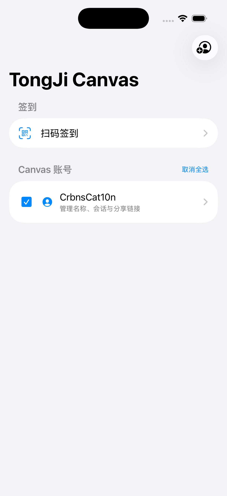

# TongJi_Canvas for iOS

TongJi_Canvas 的原生 iOS 客户端，支持账号管理、课堂二维码扫描和批量签到。

## 使用指南

1. 点击右上角 **添加账号** 按钮，进入同济大学统一身份认证页面。登录成功后，系统会自动提取认证信息并保存至主页的 Canvas 用户列表。也可以新建空账号手动输入 Cookie 信息。
2. 在主页批量勾选已保存的用户，点击 **扫码签到** 进行批量签到。
3. 支持在账号详情页一键复制网页版签到链接。

**支持系统：iOS 17.0 及以上版本。**
**ipa包未签名，请自行签名安装。**

<table>
  <tr>
    <td align="center"></td>
  </tr>
</table>

### 目录结构

```text
ios/
├── TongJiCanvas.xcodeproj/
│   ├── project.pbxproj
│   └── xcshareddata/
│       └── xcschemes/                 # Xcode 共享构建方案
├── TongJiCanvas/
│   ├── TongJiCanvasApp.swift          # 应用入口
│   ├── ContentView.swift              # 主页与账号管理
│   ├── AccountStore.swift             # 账号与 Keychain 凭据管理
│   ├── CanvasSessionCookie.swift      # 自定义 Cookie 配置
│   ├── CanvasLoginView.swift          # 统一认证登录界面
│   ├── CanvasLoginController.swift    # 登录流程与会话获取
│   ├── CanvasScannerView.swift        # 扫码签到界面
│   ├── NativeQRScannerView.swift      # 相机二维码扫描
│   ├── CanvasSignInClient.swift       # Canvas 签到请求与结果解析
│   ├── TongJiCanvas.entitlements      # 应用权限配置
│   └── Assets.xcassets/               # 图标与图片资源
└── Package.swift                      # Swift Package 配置
```

### 待完善
- 课程组；
- 签到历史。。